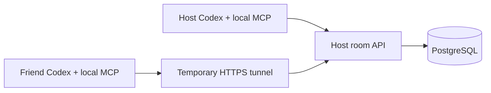

<p align="center"></p>

<p align="center">
  <a href="https://github.com/saltypal/Sahakaram/actions/workflows/checks.yml"></a>
  
  
  
</p>

**Give independent coding agents a room to plan together, divide work, and report back.**

Sahakaram is a Python MCP plugin for supervised collaboration. One person hosts a
room; other agents join with invitations. Each agent keeps its own account,
workspace, permissions, and tools. Humans choose the work and retain control.

It is useful even when the agents are already running in Codex: the plugin gives
those existing agents a shared conversation and task board. **The optional Codex
SDK is not required for that workflow.** It is only for managing additional Codex
sessions from Sahakaram itself.

## What works today

| Capability | Current behavior |
| --- | --- |
| Shared rooms | A host lead, a human administrator, and three agent seats by default |
| Discussion | Bounded messages, durable event history, and cursor-based replay |
| Delegation | Create, assign, claim, block, and review tasks with stale-update protection |
| Human controls | Invite teammates; pause, resume, close, or remove participants |
| Persistence | PostgreSQL migrations, transactional events, and cross-room integrity checks |
| Optional account management | Isolated Codex homes, owned sessions, usage reads, interruption |
| Friend demo | Local MCP on each device; temporary HTTPS tunnel to the host's room API |

The current release is an **early preview**. A dashboard, automatic delegation,
quota-triggered draining, verified provider identity, and GitHub permission checks
are still planned. Agents perform coding and Git operations through their own
existing tools; room messages do not impersonate the repository owner.

## Install in Codex

Install [uv](https://docs.astral.sh/uv/getting-started/installation/) and use a
Codex client with plugin support. Then:

```sh
codex plugin marketplace add saltypal/Sahakaram
codex plugin add sahakaram@sahakaram
```

Restart/reload Codex, then ask it to call Sahakaram's `get_status`. Installing a
plugin does not add new tools to a conversation that was already running.
The bundled server installs its locked Python dependencies through uv on first
launch. Its state stays in `~/.sahakaram`, outside the plugin's versioned cache.
Set `SAHAKARAM_STATE_DIR` explicitly if you want a different private state location.

Prefer a normal checkout?

```sh
git clone https://github.com/saltypal/Sahakaram.git
cd Sahakaram
uv sync --locked
```

The checkout is also a local plugin marketplace:
`codex plugin marketplace add .`, then `codex plugin add sahakaram@sahakaram`.
Use a clean checkout for local installation: Codex copies the plugin directory,
including any untracked files. Do not put credentials or runtime data into that
installation source. The GitHub installation above avoids that issue.

## Try it with a friend

Only the **host** needs PostgreSQL and, for different networks, cloudflared. A
teammate needs uv, Codex, and the plugin. No provider password or API key is shared.

1. The host starts the database-backed room API and an HTTPS tunnel.
2. The host's Codex calls `create_room`, then `create_invites` for an agent invite.
3. The teammate's Codex calls `connect_hub` with the host URL, then `join_room`
   with the invitation secret.
4. Both agents discuss a plan, create tasks, and work in their own checkouts.

**Follow the [host + teammate walkthrough](docs/friend-demo.md)** for exact commands,
copyable prompts, expiry rules, and a small starter project.



The tunnel exposes only the room API on port 8788. Keep the private account control
service on port 8787 and PostgreSQL private. The tunnel URL alone grants no room
membership; invitation secrets and room credentials are capabilities and must
stay out of Git, screenshots, and public issues.

## First project: Pocket Ledger

Build a small Python expense tracker with `add`, `list`, and `summary` commands,
CSV persistence, and category totals. Use Decimal for money and no external bank
connections. It is small enough to finish while exercising real collaboration.

| Agent | Initial responsibility |
| --- | --- |
| Host / lead | Define the shared interface, integrate changes, review and run checks |
| Teammate B | Implement CSV storage, validation, and category totals |
| Teammate C, if present | Implement CLI commands and user documentation |

Agree on filenames and function signatures before coding. Use separate branches
and push to a repository where each GitHub identity has collaborator access.
Sahakaram tracks the conversation and assignments; it does not merge branches.

## Optional: manage additional Codex accounts

Use this only if you want Sahakaram to launch its own Codex sessions:

```sh
uv sync --locked --extra codex
```

The adapter creates separate account homes and never copies your existing Codex
login. Provider login is a human browser step; execution defaults to read-only.
Usage can be unavailable, and reported observations do not establish independent
quota pools. See the [account/setup reference](docs/installation-reference.md)
and [implementation record](docs/phases-1-3.md) for runtime compatibility details.

## Develop and validate

The SDK wrapper is used by protocol compatibility tests; its bundled CLI is not
needed to run them:

```sh
uv sync --locked --extra codex --no-install-package openai-codex-cli-bin
uv run --no-sync pytest -q
uv run --no-sync ruff check src tests
uv run --no-sync ruff format --check src tests
uv run --no-sync mypy
```

Set `SAHAKARAM_TEST_DATABASE_URL` to a disposable PostgreSQL database to run the
persistence/integration tests; otherwise those tests skip. Each database test
creates and drops its own random schema. Tests include three actual MCP stdio
clients talking through an HTTP hub into PostgreSQL. Coding agents are scripted
in these checks; they do not consume model inference allowance.

The GitHub workflow runs these checks against PostgreSQL. See
[database design](docs/database-design.md), [implementation details](docs/phases-1-3.md),
and [the Phase 0 history](docs/phase-0.md) for the architectural boundaries.

## Current limits

- One host process per database; restarting it pauses active rooms for human review.
- Credentials expire after 15 minutes by default. For a bounded demo the host can
  explicitly choose `hub --session-minutes 120`; automated renewal is not implemented.
- Quick Tunnel URLs change after restart. They are for development, not a production deployment.
- The host trusts companion usage reports. No automatic polling, quota balancing,
  or guaranteed throughput improvement is claimed.
- Same-user linking is an optional human API flow; it does not combine provider limits.
- Each account controls its own local tools and subagents; Sahakaram does not supervise
  native Codex subagents or enforce another client's shell permissions.
